

<a href="https://inferlabs.tech"></a>

[**InferLabs**](https://inferlabs.tech) &nbsp;·&nbsp; [LinkedIn](https://www.linkedin.com/in/saurav-neupane-755077315/) &nbsp;·&nbsp; [Email](mailto:sauravneupane031@gmail.com) &nbsp;·&nbsp; [Repositories](https://github.com/saurav0311?tab=repositories)

 

I'm a CS undergraduate who builds applied machine learning systems end to end — 
from raw data and evaluation to something deployed and actually usable, 
working where **ML research** meets **backend engineering**.

 

<a href="https://inferlabs.tech"></a>

**InferLabs** is my AutoML platform for tabular data — upload a CSV and it validates the data, preprocesses it automatically, 
trains and compares regression models by cross-validation, then evaluates, versions and serves predictions. Designed, built and deployed by me.

<a href="https://inferlabs.tech">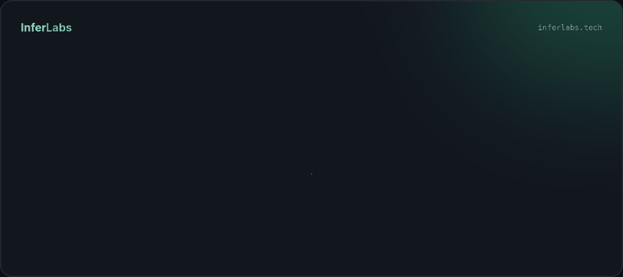</a>

[**→ Try it live**](https://inferlabs.tech) &nbsp;&nbsp;·&nbsp;&nbsp; [Share feedback](mailto:sauravneupane031@gmail.com?subject=InferLabs%20feedback) &nbsp;&nbsp;·&nbsp;&nbsp; Classification coming in V2

  

<!-- TODO: wrap each card in <a href="https://github.com/saurav0311/REPO">…</a> once the repository is public -->
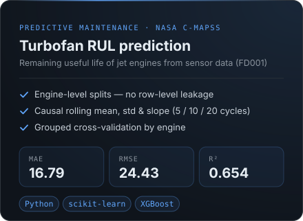
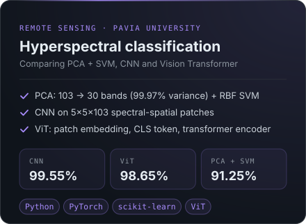

<!--
Concrete Printability Prediction — uncomment and add a card once the repository is public.
Applied ML research predicting yield stress and plastic viscosity for 3D concrete printing.
-->

  

<a href="https://github.com/saurav0311/hybrid-ids-nsl-kdd"></a>
<a href="https://github.com/saurav0311/eye-disease-predictor"></a>
<a href="https://github.com/saurav0311/customer-churn"></a>
<a href="https://github.com/saurav0311/dynamic-ride-pricing"></a>
<a href="https://github.com/saurav0311/house-price-prediction"></a>

  


  


  

